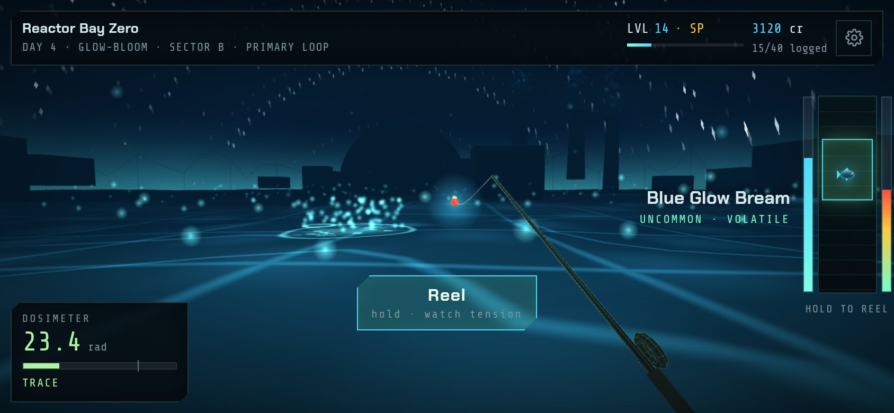
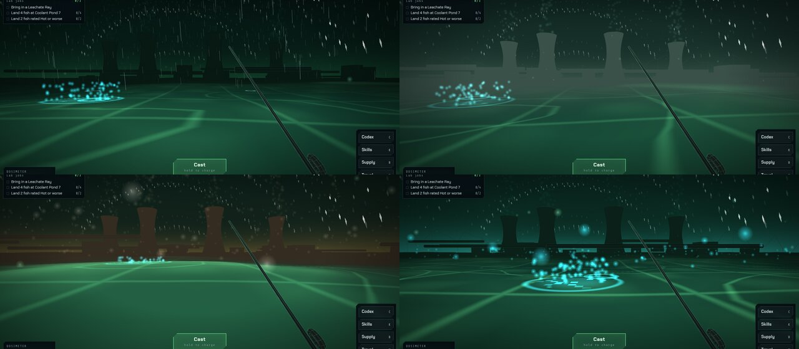
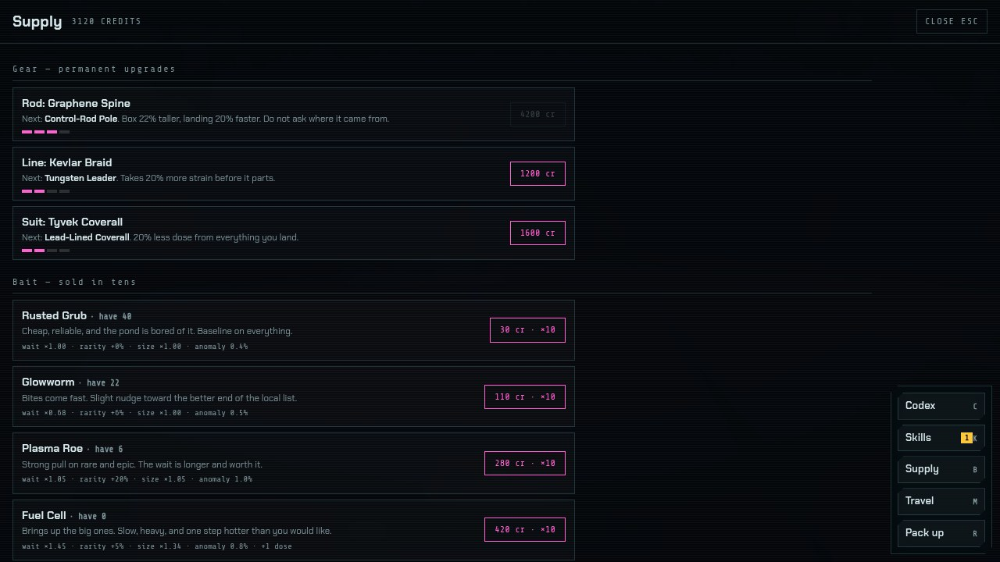

<p align="center">
  
</p>

<h1 align="center">Toxic Fishing</h1>

<p align="center">
  A first-person fishing game in irradiated water.<br>
  Log forty species, keep your dose under the line, and get home before the water gets into your dreams.
</p>

<p align="center">
  <strong><a href="https://neruodissident.github.io/toxic-fishing/">▶ Play it</a></strong>
</p>

<p align="center">
  
</p>

---

Six contaminated locations, forty species, three lab jobs every morning, and a dosimeter that does not care how good the fish was. Runs in any modern browser, installs to a phone home screen, and works with no connection once it has loaded.

No build step, no dependencies to install, no bundler. One HTML file and a vendored copy of three.js.

## Install it on a phone

The game is a PWA, so it can live on the home screen and launch without browser chrome.

- **Android / Chrome** — open the link, then `⋮` → *Add to Home screen*. Chrome usually offers an install prompt on its own.
- **iOS / Safari** — open the link, tap the share button, then *Add to Home Screen*. It has to be Safari; other iOS browsers don't offer the option.

Once installed it runs fullscreen in landscape or portrait, and works offline. Your progress is saved on the device.

## Controls

| | Touch | Keyboard |
|---|---|---|
| Look around | drag anywhere | `A` / `D`, or arrow keys |
| Cast | hold **Cast**, release at the power you want | hold `space`, release |
| Set the hook | tap **Set the hook** when the line jumps | `space` |
| Reel | hold **Reel** in bursts | hold `space` |
| Change bait | tap the bait strip | `1`–`6` |
| Codex / Skills / Supply / Travel | the menu buttons | `C` / `K` / `B` / `M` |
| Lab jobs | tap the jobs panel | `J` |
| Pack up for the night | **Pack up** | `R` |
| Settings | the gear icon, top right | — |

While you charge a cast, a ring on the water shows exactly where it will land. Distance sets depth, and deeper water biases the roll toward rarer fish. Aim matters too: each visit has one **hotspot**, a boiling patch on the water, and landing inside it strengthens the pull toward rare and brings bites 25% sooner. It goes quiet after three catches and starts boiling somewhere else.

The first two fights are coached live. A panel beside the track reads the actual fight state and tells you what to do: hold, let go, or ride out a surge. You can replay it from Settings.

## How it works

**The fight.** A containment box you hold up against gravity, with the quarry moving on a pattern set by its species. Progress fills on the left bar while the fish is inside the box. The real mechanic is the tension bar on the right. Hovering the box in place costs about 37% of your hold-time; the tension budget gives you roughly 50%. That gap is everything you have to chase the fish with. Surges telegraph and then sharply raise the rate tension climbs — hold through one and the line parts. You lose fish by being greedy, not by being slow. Later waters fight harder, up to a third harder at The Blight Shelf, which is what gear is for.

<p align="center">
  
</p>

**Lab jobs.** Every morning the lab posts three: land a particular species, a trophy-length specimen, a Rare from a named water, a haul from one location, fish rated Trace or Clean, or fish rated Hot or worse. They pay out the moment the fish that finishes one lands, rewards scale with your level, and whatever is left when you pack up is cleared.

<p align="center">
  
</p>

**Conditions.** Every water rolls its own weather each day, seeded so a reload never rerolls it. Each one changes the odds as well as the look: acid rain brings bites sooner but adds dose, dense fog draws better fish up, an ash storm raises sale prices but shortens the box, and a glow-bloom doubles anomaly odds at the cost of extra dose. The Travel screen shows today's weather for every water, so where you go is a decision.

<p align="center">
  
  <br><sub>The same pond in acid rain, dense fog, an ash storm and a glow-bloom</sub>
</p>

**Toxicity.** Every species carries a rating from Clean to Critical, and landing one adds to your dose. Past 50 rad your hands shake and the bracket jitters. Past 75 the water starts producing ripples from nothing. Hit 100 and you black out, lose 40% of your credits, and wake up the next day with an affliction. Clean fish *subtract* dose, which is what makes the handful of non-toxic species worth hunting rather than just worth points.

**Sleep.** Packing up sheds 70% of your dose and advances the day — but the threshold check runs on the dose you're carrying *before* the shed. Over 45 rad and you sleep badly, waking with a random affliction (shorter bracket, faster tension, slower bites, less experience, or a twitchier quarry) that lasts until the next night. So decontamination belongs *before* you pack up, not after. That 45-rad line is the entire reason the tablets exist.

**Progression.** Experience buys skill points across three trees: Angler (the fight), Scavenger (money and rarity), and Hazmat (dose management). Hot Market in the Hazmat tree inverts the toxicity sale penalty into a premium, which is the build that makes deliberately catching filth correct. Locations unlock on level and a gate fee, ending at The Blight Shelf, past the last marker post, where the water is clean — which is the worst thing about it.

**Gear.** Credits outlast the gate fees, so Supply sells permanent upgrades on top of your skills: a rod (taller box, faster landing), a line (more strain before it parts), and a suit (less dose from everything you land). Four tiers each, up to about 18,000 credits for the full set.

**Codex.** Forty entries with size records, catch counts, and toxicity, tracked per location. Uncaught species show as silhouettes. Finishing a water's six entries grants a permanent perk tied to that water, shown on the page before you earn it. Logging all forty ends the survey with an epilogue, and the game carries on.

**Mutations.** Any fish can come up mutated: recoloured, a little harder to land, worth three times as much and double the experience. They have their own forty-entry collection, and finishing the survey makes them three times as common.

<p align="center">
  
  
</p>

<p align="center">
  
  <br>
  <sub>A coached first fight on a phone</sub>
</p>

**Settings.** Sound on or off, separate music and effects volume, vibration on bites, surges and catches (Android; iOS Safari doesn't expose it), a graphics tier, coaching replay, and save erase. Settings are stored apart from the save, so erasing a shift keeps them.

<details>
<summary><strong>Locations and species</strong> (spoilers)</summary>

| Location | Unlocks at | Species |
|---|---|---|
| Coolant Pond 7 | start | Rustgill Minnow, Ditchwater Roach, Coolant Carp, Chrome Eel, Isotope Pike, Turbine Ghost |
| The Drowned District | level 4 | Gutter Shiner, Payphone Perch, Meter-Reader Bass, Subway Lamprey, Billboard Marlin, The Concierge |
| Ashfall Ridge | level 8 | Cinder Trout, Ashback Chub, Emberjaw, Slagfin Char, Magma Sturgeon, Phoenix Gar |
| Tailings Basin | level 12 | Sulfur Guppy, Slurry Sucker, Cyanide Tetra, Tailings Catfish, Leachate Ray, Basin Regent |
| Reactor Bay Zero | level 16 | Cherenkov Smelt, Control Rod Loach, Blue Glow Bream, Graphite Grouper, Criticality Barb, Core Serpent |
| The Blight Shelf | level 22 | Spore Fry, Pallid Drifter, Gloamfin, Weeping Skate, Shelfwalker, Mother of Hooks |
| Anywhere | — | Half-Life Halibut, The Understudy, Geiger Angel, Null Carp |

The four anomalies turn up in any water. A Null Lure finds them at roughly 15%; everything else is closer to 1%.

</details>

## Running it locally

A service worker needs a real origin, so open it through a server rather than `file://`.

```sh
git clone https://github.com/NeruoDissident/toxic-fishing.git
cd toxic-fishing
python3 -m http.server 8000
```

Then open `http://localhost:8000`. That counts as a secure origin, so the PWA and offline caching work.

## Notes for editing it

- **The game is `index.html`.** All of it — markup, CSS, data tables, three.js scene, game logic. Around 2,500 lines.
- **Fish are data, not assets.** Each species is one row in the `FISH` table with a set of shape parameters (`b`, `l`, `tail`, `fin`, `spikes`, `eyes`, `pat`, colors, `extra`). `fishArt()` paints them procedurally to a canvas, and that same texture is used for the codex card, the fight marker, and the sprite that leaps out of the water. Adding a species is adding a row.
- **Locations are data too.** One row in `LOCS` sets the palette, fog, water color, and which prop builder runs. The builders live in `W.build()`. `LOCDIFF` sets how much harder each water fights, and `CONDW` sets which weather each water can roll and how often.
- **The other systems are tables as well.** `GEAR` (tiers, costs, multipliers), `CONDS` (weather names and effects), `PERKS` (codex page rewards), and the job makers inside `genJobs()`. Every multiplier meets in `G.st` and `rollFish()`, so that is where to look when something feels off.
- **The hotspot and the aim ring are drawn in the water shader**, not as meshes, so wave crests can't hide or z-fight them. `W.setHot()` and `W.setAim()` set the uniforms.
- **Tuning lives in two places.** `G.st` holds the derived fight stats (bracket size, tension rate, progress rate), and `stepFight()` holds the physics. The bracket is a damped thruster: acceleration up when held, a weaker constant pull down, and a damping term that settles velocity in about 0.17s. Change the damping constant first if the feel is off.
- **Saves** are one `localStorage` key, `toxicfishing.v1`, written after every catch and whenever the app is backgrounded mid-shift. New fields get defaults on load, so older saves carry forward. Settings are a separate key, `toxicfishing.opt`.
- **Phones get a lighter scene.** `MOBILE` is detected once at load from `pointer:coarse` (a width test alone misses a landscape phone, which is wider than most breakpoints), and `Q` drops water tessellation, pixel ratio, particle counts and building count. The Graphics setting overrides it. Worth knowing: `dt` is clamped at 20fps, so a device slower than that runs in slow motion rather than dropping frames.

### Testing it

`tests/e2e.js` drives the real game in headless Chrome and inspects live state: the coached first catch on a phone, migrating an old save, buying gear through Supply, every panel, every weather, the hotspot's effect on the odds, lab jobs, a codex perk, a mutation, the 40/40 ending, a reload round-trip, and real fights in a late water.

```sh
npm i --no-save puppeteer-core
python3 -m http.server 8766 &
node tests/e2e.js http://localhost:8766      # set CHROME=/path/to/chrome if it isn't found
```

### Publishing it

The site is the repository root — there is no build step, so Pages serves it directly. Under **Settings → Pages**, set the source to *Deploy from a branch*, branch `main`, folder `/ (root)`. It goes live at `https://neruodissident.github.io/toxic-fishing/` a minute or two later.

On every deploy after that, bump `CACHE` in `sw.js`. The service worker serves from cache first, so a stale build will otherwise stay installed on anyone who already has it:

```js
const CACHE = 'toxic-fishing-v3';   // was v2
```

`.nojekyll` is present so paths starting with an underscore aren't swallowed.

## What's vendored and why

Both are checked in so the installed app makes **zero external requests** and works offline the moment it's added to a home screen.

- `vendor/three.min.js` — three.js r128, MIT, license in `vendor/three.LICENSE`
- `assets/fonts/` — Chakra Petch and Share Tech Mono, latin subsets, both SIL Open Font License

## License

MIT. See `LICENSE`.
