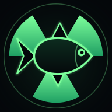
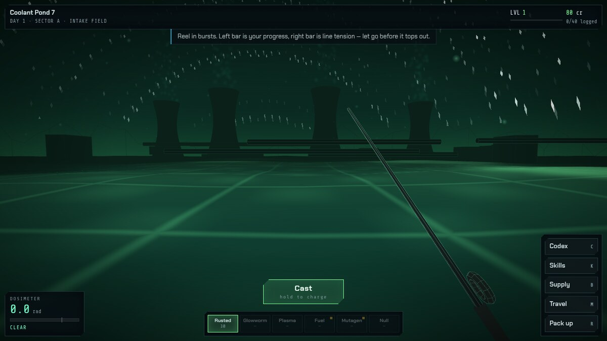
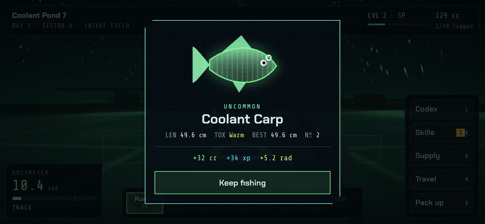
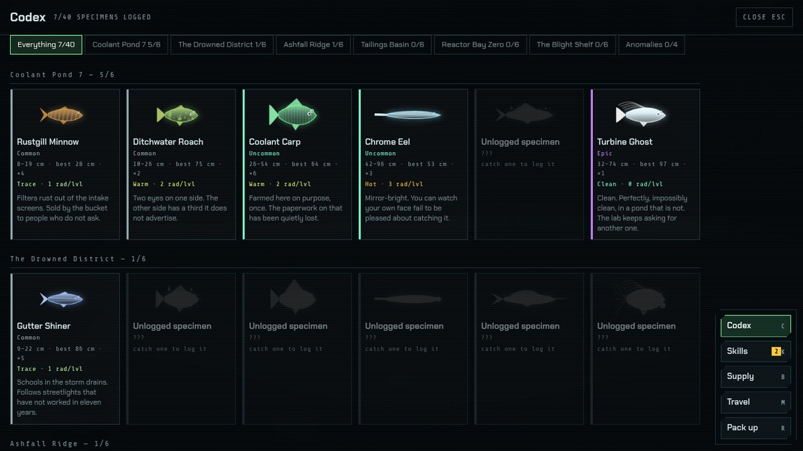
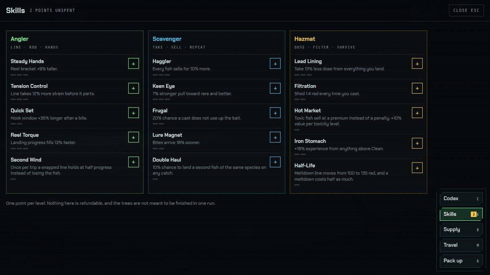
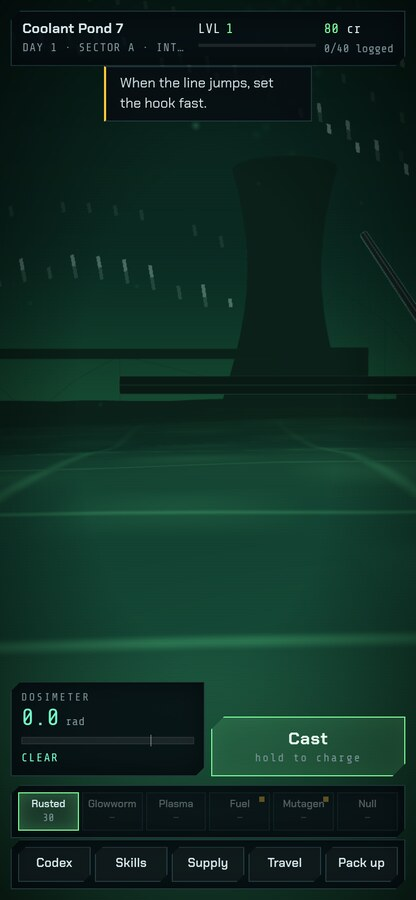

<p align="center">
  
</p>

<h1 align="center">Toxic Fishing</h1>

<p align="center">
  A first-person fishing game in irradiated water.<br>
  Log forty species, keep your dose under the line, and get home before the water gets into your dreams.
</p>

<p align="center">
  <strong><a href="https://neruodissident.github.io/toxic-fishing/">▶ Play it</a></strong>
</p>

<p align="center">
  
</p>

---

Six contaminated locations, forty species, and a dosimeter that does not care how good the fish was. Runs in any modern browser, installs to a phone home screen, and works with no connection once it has loaded.

No build step, no dependencies to install, no bundler. One HTML file and a vendored copy of three.js.

## Install it on a phone

The game is a PWA, so it can live on the home screen and launch without browser chrome.

- **Android / Chrome** — open the link, then `⋮` → *Add to Home screen*. Chrome usually offers an install prompt on its own.
- **iOS / Safari** — open the link, tap the share button, then *Add to Home Screen*. It has to be Safari; other iOS browsers don't offer the option.

Once installed it runs fullscreen in landscape or portrait, and works offline. Your progress is saved on the device.

## Controls

| | Touch | Keyboard |
|---|---|---|
| Look around | drag anywhere | `A` / `D`, or arrow keys |
| Cast | hold **Cast**, release at the power you want | hold `space`, release |
| Set the hook | tap **Set the hook** when the line jumps | `space` |
| Reel | hold **Reel** in bursts | hold `space` |
| Change bait | tap the bait strip | `1`–`6` |
| Codex / Skills / Supply / Travel | the right-hand buttons | `C` / `K` / `B` / `M` |
| Pack up for the night | **Pack up** | `R` |

Cast power sets distance, and distance sets depth. Deeper water biases the roll toward rarer fish, so a full-power cast is worth the extra second of charge.

## How it works

**The fight.** A containment bracket you hold up against gravity, with the quarry moving on a pattern set by its species. The real mechanic is the tension bar on the right. Hovering the bracket in place costs about 37% of your hold-time; the tension budget gives you roughly 50%. That gap is everything you have to chase the fish with. Surges telegraph for 0.6 seconds and then triple the rate tension climbs — hold through one and the line parts. You lose fish by being greedy, not by being slow.

<p align="center">
  
</p>

**Toxicity.** Every species carries a rating from Clean to Critical, and landing one adds to your dose. Past 50 rad your hands shake and the bracket jitters. Past 75 the water starts producing ripples from nothing. Hit 100 and you black out, lose 40% of your credits, and wake up the next day with an affliction. Clean fish *subtract* dose, which is what makes the handful of non-toxic species worth hunting rather than just worth points.

**Sleep.** Packing up sheds 70% of your dose and advances the day — but the threshold check runs on the dose you're carrying *before* the shed. Over 45 rad and you sleep badly, waking with a random affliction (shorter bracket, faster tension, slower bites, less experience, or a twitchier quarry) that lasts until the next night. So decontamination belongs *before* you pack up, not after. That 45-rad line is the entire reason the tablets exist.

**Progression.** Experience buys skill points across three trees: Angler (the fight), Scavenger (money and rarity), and Hazmat (dose management). Hot Market in the Hazmat tree inverts the toxicity sale penalty into a premium, which is the build that makes deliberately catching filth correct. Locations unlock on level and a gate fee, ending at The Blight Shelf, past the last marker post, where the water is clean — which is the worst thing about it.

**Codex.** Forty entries with size records, catch counts, and toxicity, tracked per location. Uncaught species show as silhouettes.

<p align="center">
  
  
</p>

<p align="center">
  
  <br>
  <sub>Portrait phone layout</sub>
</p>

<details>
<summary><strong>Locations and species</strong> (spoilers)</summary>

| Location | Unlocks at | Species |
|---|---|---|
| Coolant Pond 7 | start | Rustgill Minnow, Ditchwater Roach, Coolant Carp, Chrome Eel, Isotope Pike, Turbine Ghost |
| The Drowned District | level 4 | Gutter Shiner, Payphone Perch, Meter-Reader Bass, Subway Lamprey, Billboard Marlin, The Concierge |
| Ashfall Ridge | level 8 | Cinder Trout, Ashback Chub, Emberjaw, Slagfin Char, Magma Sturgeon, Phoenix Gar |
| Tailings Basin | level 12 | Sulfur Guppy, Slurry Sucker, Cyanide Tetra, Tailings Catfish, Leachate Ray, Basin Regent |
| Reactor Bay Zero | level 16 | Cherenkov Smelt, Control Rod Loach, Blue Glow Bream, Graphite Grouper, Criticality Barb, Core Serpent |
| The Blight Shelf | level 22 | Spore Fry, Pallid Drifter, Gloamfin, Weeping Skate, Shelfwalker, Mother of Hooks |
| Anywhere | — | Half-Life Halibut, The Understudy, Geiger Angel, Null Carp |

The four anomalies turn up in any water. A Null Lure finds them at roughly 15%; everything else is closer to 1%.

</details>

## Running it locally

A service worker needs a real origin, so open it through a server rather than `file://`.

```sh
git clone https://github.com/NeruoDissident/toxic-fishing.git
cd toxic-fishing
python3 -m http.server 8000
```

Then open `http://localhost:8000`. That counts as a secure origin, so the PWA and offline caching work.

## Notes for editing it

- **The game is `index.html`.** All of it — markup, CSS, data tables, three.js scene, game logic. Around 1,900 lines.
- **Fish are data, not assets.** Each species is one row in the `FISH` table with a set of shape parameters (`b`, `l`, `tail`, `fin`, `spikes`, `eyes`, `pat`, colors, `extra`). `fishArt()` paints them procedurally to a canvas, and that same texture is used for the codex card, the fight marker, and the sprite that leaps out of the water. Adding a species is adding a row.
- **Locations are data too.** One row in `LOCS` sets the palette, fog, water color, and which prop builder runs. The builders live in `W.build()`.
- **Tuning lives in two places.** `G.st` holds the derived fight stats (bracket size, tension rate, progress rate), and `stepFight()` holds the physics. The bracket is a damped thruster: acceleration up when held, a weaker constant pull down, and a damping term that settles velocity in about 0.17s. Change the damping constant first if the feel is off.
- **Saves** are one `localStorage` key, `toxicfishing.v1`, written after every catch. The title screen has a wipe link.
- **Phones get a lighter scene.** `MOBILE` is detected once at load from `pointer:coarse` (a width test alone misses a landscape phone, which is wider than most breakpoints), and `Q` drops water tessellation, pixel ratio, particle counts and building count. Worth knowing: `dt` is clamped at 20fps, so a device slower than that runs in slow motion rather than dropping frames.

### Publishing it

The site is the repository root — there is no build step, so Pages serves it directly. Under **Settings → Pages**, set the source to *Deploy from a branch*, branch `main`, folder `/ (root)`. It goes live at `https://neruodissident.github.io/toxic-fishing/` a minute or two later.

On every deploy after that, bump `CACHE` in `sw.js`. The service worker serves from cache first, so a stale build will otherwise stay installed on anyone who already has it:

```js
const CACHE = 'toxic-fishing-v2';   // was v1
```

`.nojekyll` is present so paths starting with an underscore aren't swallowed.

## What's vendored and why

Both are checked in so the installed app makes **zero external requests** and works offline the moment it's added to a home screen.

- `vendor/three.min.js` — three.js r128, MIT, license in `vendor/three.LICENSE`
- `assets/fonts/` — Chakra Petch and Share Tech Mono, latin subsets, both SIL Open Font License

## License

MIT. See `LICENSE`.
